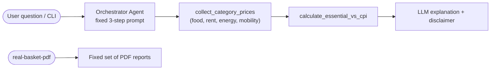
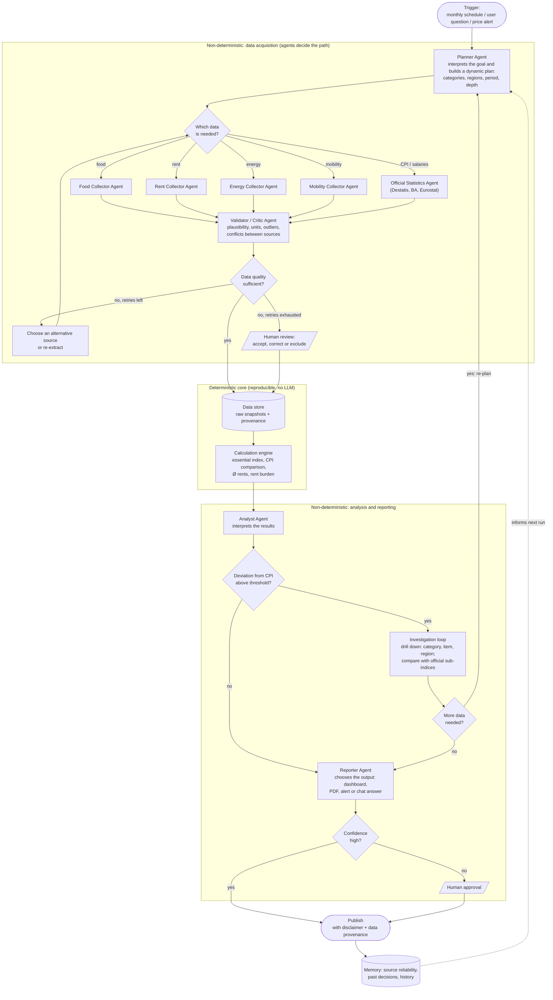

# Process Flow Redesign: from deterministic pipeline to non-deterministic agentic process

## 1. Current state: deterministic

Today RealBasket is essentially a **fixed pipeline**. The orchestrator prompt prescribes the steps
(collect → calculate → explain), the tools return deterministic (demo) data, the calculations are pure
functions, and the PDF reports are a fixed script. The only non-deterministic element is the wording of
the LLM answer and which tool it picks for a question.

| Aspect | Current behaviour |
|--------|-------------------|
| Control flow | Fixed, defined by prompt / script |
| Data sources | Fixed (demo generator) |
| Error handling | None needed (data cannot fail) |
| Analysis depth | Same for every question |
| Output | Fixed answer format / fixed PDF set |

## 2. Is a non-deterministic process possible? Yes.

A non-deterministic flow, where the agents decide the path at runtime, adds real value wherever the path
**cannot be known in advance**:

| Problem in the real world | Why a fixed flow fails | What the agent decides at runtime |
|---------------------------|------------------------|-----------------------------------|
| Price sources are heterogeneous (APIs, web pages, PDFs), change or go offline | Hard-coded scrapers break | Which source to use, alternative sources, how to extract |
| Data quality varies (outliers, unit errors, missing months, conflicting sources) | No recovery path | Retry, cross-check, exclude, or escalate to a human |
| Deviation between essential index and CPI needs explanation | Same shallow answer every time | Whether and how deep to drill down (category → item → region) |
| Users ask very different questions | One generic plan | A dynamic plan per question (scope, regions, period) |
| Different outputs are relevant per situation | Always the same PDFs | Dashboard update, PDF, alert, or chat answer |

**Design principle: non-deterministic shell, deterministic core.**

- **Non-deterministic (LLM agents):** planning, source selection, extraction, validation judgement,
  investigation, report composition.
- **Deterministic (plain code, no LLM):** index calculation, CPI comparison, averages, rent burden.
  The numbers must be **reproducible** from the stored data set, because an LLM must never "calculate" an
  inflation rate.

## 3. Target use case: "Autonomous essential price monitoring & deviation investigation"

**Trigger:** monthly schedule, a user question, or a price alert (e.g. a fuel price jump).
**Goal:** produce a validated, explained essential living cost index for the month, and investigate
autonomously whenever it deviates noticeably from the official CPI.

### Process diagram

### Why this flow is non-deterministic

- **Dynamic branching:** the planner decides at runtime which collectors run, for which regions and periods.
- **Loops with an unknown number of iterations:** the validation loop (alternative sources) and the
  investigation loop (re-planning when more data is needed).
- **LLM judgement at decision points:** data quality, whether a deviation is relevant, which output fits.
- **Learning across runs:** source reliability and earlier decisions from memory shape the next plan.
- Two runs with the same trigger can therefore take **different paths**, but they produce
  **reproducible numbers** for the same stored data set.

## 4. Guardrails

| Risk | Mitigation |
|------|------------|
| Hallucinated prices | Every price needs a source URL / API and a stored raw snapshot; the validator rejects values without provenance |
| Endless loops / cost | Max. retries per source, max. investigation depth, token / time budget per run |
| Non-reproducible numbers | All calculations run in deterministic code on the stored data set; the data set is versioned per run |
| Misleading conclusions | The disclaimer is mandatory in every output ("a deviation does not mean the CPI is wrong") |
| Low-confidence results | Human-in-the-loop before publishing (Strands interrupts) |
| Traceability | Audit log of plan, chosen sources, decisions and iterations per run |

## 5. Mapping to Strands Agents

| Process element | Strands building block |
|-----------------|------------------------|
| Planner → collectors → validator with conditional edges and loops | `strands.multiagent` **Graph** (conditional edges, cycles) |
| Collectors handing off between each other (e.g. rent ↔ official statistics) | **Swarm** pattern / agents-as-tools |
| Deterministic calculation engine | Plain `@tool` functions wrapping `core/` (already in place) |
| Human review / approval | Strands **interrupts** (`InterruptResponseContent`) |
| Memory / history across runs | Session manager (`FileSessionManager` / `S3SessionManager`) + data store |
| Source discovery | Web search / fetch tools, MCP servers |

## 6. Implementation roadmap

1. **Data store + provenance:** persist every data point with source and raw snapshot (precondition for everything else).
2. **Validator agent + retry loop**, still with the fixed set of collectors.
3. **Real collectors** per category, with alternative sources and a source registry.
4. **Planner agent + Graph orchestration**, replacing the fixed 3-step prompt.
5. **Investigation loop** for deviations above the threshold.
6. **Human-in-the-loop** (interrupts) and **memory** of source reliability.
7. **Scheduler trigger** (monthly run) and alerting.

## 7. Implementation status (November 2026)

Steps 1, 2, 4, 5 and 6 are implemented in `src/real_basket/flow/`; steps 3 and 7 are open (still demo sources,
no scheduler). Run with `poetry run real-basket-flow` or the **🔄 Monitoring runs** tab of the dashboard.

| Design element | Implementation |
|----------------|----------------|
| Planner / Collector / Validator / Analyst / Reporter | Five Strands agents (`REALBASKET-PLANNER`, …) as nodes of a `strands.multiagent.GraphBuilder` graph, each with its own tools (`flow/tools.py`) |
| Fixed calculation engine | Deterministic `FunctionNode`s (`plan_gate`, `quality_checks`, `validation_gate`, `calculate`, `release_gate`, `publish`) wrapping `core/engine.py`, `core/validation.py` |
| Loops | Conditional edges: validator → collector (retry with alternative source), analyst → planner (re-plan), investigation tool calls inside the analyst |
| Hallucinated prices | Prices only enter via `fetch` from the source registry; every row carries its source; raw snapshot stored per fetch; missing provenance is a critical issue |
| Critical data | Hard rule in code: a dataset with critical issues can never be accepted, whatever the validator agent decides |
| Endless loops / cost | `MAX_SOURCE_ATTEMPTS`, `MAX_INVESTIGATION_STEPS`, `MAX_REPLANS`, `MAX_NODE_EXECUTIONS`, `RUN_TIMEOUT_S` |
| Reproducible numbers | Accepted data stored as `dataset.json` with hash; tests recompute the results from it |
| Mandatory disclaimer | Appended by code (demo-data note, provenance footer, disclaimer) — the reporter cannot drop it |
| Human-in-the-loop | Pluggable approver (`deferred` → approve / reject in the dashboard, `interactive` CLI, `auto` demo); confidence is computed in code from data quality and coverage. Strands interrupts are not used yet |
| Memory | `data_store/memory.json`: source reliability and past results, given to the planner of the next run |
| Audit | `audit.jsonl` per run: plan, fetches, validator decisions, gates, investigations, human decisions |

**Remaining randomness vs. reproducibility:** two runs may plan differently, pick different sources, retry a
different number of times or investigate differently (demo sources fail randomly, `DEMO_FAULT_RATE`). For the
same stored `dataset.json`, the numbers are always identical.
