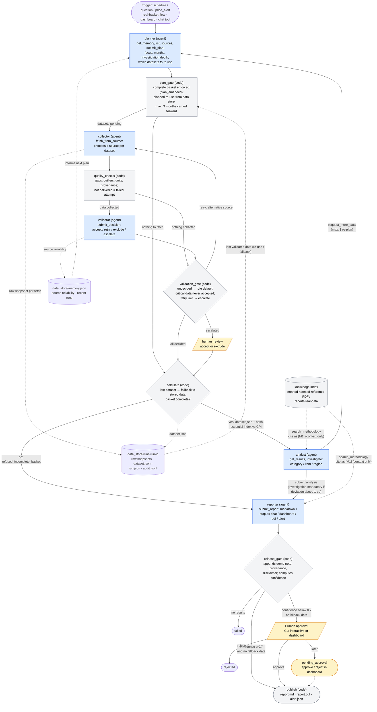
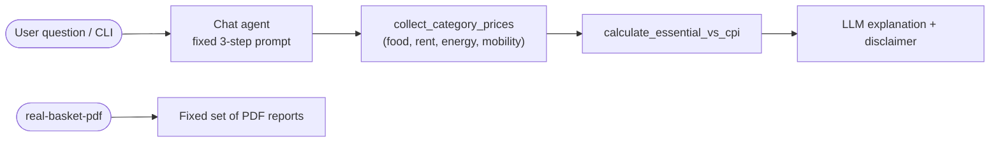

# Process Flow: non-deterministic agentic monitoring with a deterministic core

> Status: November 2026. This document describes the **implemented** process (`src/real_basket/flow/`).
> The original deterministic pipeline is kept in section 8 for reference only.

## 1. Current state

RealBasket has two entry points that share the same deterministic calculation core (`core/`):

| Entry point | Behaviour | Orchestration |
|-------------|-----------|---------------|
| **Chat agent** `REALBASKET-ORCHESTRATOR` (dashboard chat tab, `real-basket-cli`) | Answers questions with tools (prices, essential vs CPI, regional rents, net salaries, `investigate_deviation`, `search_methodology` for method notes of the reference PDFs). Can start a monitoring run (`run_monitoring_flow`) when the user explicitly asks for fresh, validated data | Classic LLM orchestrator: the model decides which tools to call |
| **Monitoring flow** (`real-basket-flow`, dashboard tab **🔄 Monitoring runs**, chat tool) | Collects, validates, calculates, investigates and publishes one validated essential index per run | A Strands `Graph`: 5 LLM agents + 7 deterministic function nodes; routing is code (`RunContext.next_after_*`) |

Triggers of the monitoring flow: `schedule`, `question`, `price_alert` (`--trigger`). There is no scheduler yet;
a monthly run has to be started externally (e.g. Windows Task Scheduler / cron calling `real-basket-flow`).

**Design principle: non-deterministic shell, deterministic core.**

- **Non-deterministic (LLM agents):** plan (focus, history length, investigation depth, fresh vs. re-used data),
  source selection, validation judgement, investigation path, re-planning, report wording and output channels.
- **Deterministic (plain code, no LLM):** basket completeness, quality rules, retry / budget limits, index
  calculation, CPI comparison, confidence score, release gate, disclaimer and provenance. The numbers are
  **reproducible** from the stored `dataset.json` of a run; an LLM never calculates an inflation rate.

## 2. Process diagram (as implemented)

Node names are the node ids of the graph in `flow/graph.py`.

Blue = LLM agent, grey = deterministic code, yellow = human. Every node and decision is written to `audit.jsonl`;
the run summary is added to `memory.json` at the end of every run (also failed ones).

### Method notes from reference documents (RAG)

Analyst and reporter can retrieve method notes and caveats from the reference PDFs in `KNOWLEDGE_DIR`
(default `reports/real-data`, e.g. "Wohnen / Energie ist keine Nettokaltmiete"). This is the only retrieval-augmented
part of the system and it supplies **context, never numbers**:

| Step | Implementation (`src/real_basket/knowledge/`) |
|------|-----------------------------------------------|
| Ingest | pypdf text extraction; repeated headers / page numbers removed; prose → `note` passages, tables → only their *non-numeric* cells (`table` passages); numeric cells are dropped; identical passages of several yearly reports are stored once with all locations |
| Index | `data_store/knowledge/index.json`, rebuilt automatically when a PDF changes (size / mtime) |
| Retrieval | `bm25` (offline, German stemming, compounds, English → German glossary) or `embedding` (OpenAI, fused with BM25 via RRF); `auto` = embedding if an API key is set, embedding errors fall back to BM25 |
| Budget | `MAX_KNOWLEDGE_QUERIES` (3) searches per run, `KNOWLEDGE_TOP_K` (4) passages per search |
| Citation check | Each retrieved passage gets a run-wide id `[M1]`, `[M2]`; `submit_analysis` / `submit_report` are rejected when they cite an id that was not retrieved in this run (`unknown_citation_rejected`) |
| Output | The release gate appends "Method notes cited" (file, page, section); all retrieved passages are stored in `run.json` and shown in the dashboard |

Without reference documents the search returns no passages and the flow runs unchanged. The chat agent has the
same search as tool `search_methodology` (citations as `file p. N`).

### Why this flow is non-deterministic

- **Dynamic decisions:** the planner decides focus, history length, investigation depth and which datasets
  are re-used from the data store; the collector chooses the source; the validator judges the data.
  The *scope* is fixed: the essential index always uses the complete basket (section 3).
- **Loops with an unknown number of iterations:** the validation loop (retry with an alternative source,
  max. `MAX_SOURCE_ATTEMPTS`) and the re-plan loop analyst → planner (max. `MAX_REPLANS`).
- **LLM judgement at decision points:** data quality, investigation path (category → item → region),
  whether more data is needed, which output channels fit, report wording.
- **Learning across runs:** source reliability and summaries of earlier runs from `memory.json` shape the next plan.
- **Faulty demo sources:** the "error-prone" demo sources fail randomly (`DEMO_FAULT_RATE`, default 0.35),
  so the retry and escalation paths are actually exercised.

Two runs with the same trigger can therefore take **different paths**; for the same stored `dataset.json`
the numbers are always identical.

## 3. Orchestration and basket completeness

**Who orchestrates?** The monitoring flow has no central LLM supervisor on purpose. The Strands `Graph`
is the orchestrator: its conditional edges (`RunContext.next_after_*`) route the run deterministically from
the run state. The agents decide *inside* their nodes, but they cannot skip a gate, exceed a budget or bypass
human approval. The chat front door (`REALBASKET-ORCHESTRATOR`) is a classic LLM orchestrator.

**The essential index needs the complete basket.** It is a weighted basket (rent 40 %, food 30 %,
energy 15 %, mobility 15 %) compared with the headline CPI. An index over a subset with re-normalised
weights would be a *different* index: not comparable with earlier runs, and its deviation from the CPI would
be meaningless. Therefore:

| Rule (enforced in code) | Where |
|-------------------------|-------|
| Every plan covers all categories + CPI; a partial plan is amended and logged (`plan_amended`) | `RunContext.set_plan` |
| The engine refuses to calculate an incomplete basket (no silent re-weighting); only weight-0 categories may be absent | `engine.compute_results`, `engine.missing_for_basket` |
| Without the complete basket the run fails (`refused_incomplete_basket`) instead of publishing | `steps.calculate`, `steps.release_gate` |

**Where partial *retrieval* is still realistic** (the calculation always uses the complete basket):

| Scenario | Behaviour |
|----------|-----------|
| Different update frequencies (rents quarterly, CPI / fuel monthly) | The planner puts slow-moving datasets into `reuse`; they are taken from the last validated run. Up to `MAX_CARRY_FORWARD_MONTHS` (default 3) trailing months are carried forward with the last observed value, marked `(carried forward)`, confidence −0.05 per dataset |
| Re-plan / retry | Only the datasets requested by the analyst or rejected by the validator are fetched again; accepted data is kept |
| Source outage (fresh data lost after all retries) | Fallback to the last validated stored data, which **always requires human approval** (confidence −0.10); if no usable stored data exists, the run fails |
| Question about one category ("why is rent rising?") | Complete basket, `focus` = the category; the analyst explains its contribution and gap within the basket. Pure category / region questions without the index (regional rents, salaries, rent burden) are answered by the chat agent's tools |

Stored data is only re-used if it was fetched and accepted in a run that was not rejected, and never from data
that was itself re-used, so carry-forward cannot chain across runs. Stored data that is too old, has gaps or
fails the quality rules is not re-used (`reuse_unavailable` in the audit trail); the dataset is fetched fresh.

## 4. Guardrails (as implemented)

| Risk | Mitigation in code |
|------|--------------------|
| Hallucinated prices | Prices only enter via `fetch_from_source` from the source registry (`data/sources.py`); every row carries its source; a raw snapshot is stored per fetch; missing provenance is a critical issue |
| Bad data accepted | Hard rule: a dataset with critical issues can never be accepted, whatever the validator agent decides; undecided datasets get a rule-based default |
| Endless loops / cost | `MAX_SOURCE_ATTEMPTS` (3), `MAX_INVESTIGATION_STEPS` (4), `MAX_REPLANS` (1), `MAX_NODE_EXECUTIONS` (30), `RUN_TIMEOUT_S` (900) |
| Shallow explanation of a large gap | `submit_analysis` is rejected while the absolute deviation exceeds `DEVIATION_THRESHOLD_PP` (1.0 pp) and no investigation step was done |
| Non-reproducible numbers | Calculation only in `core/engine.py` on the accepted data; stored as `dataset.json` with hash per run |
| Incomparable index | Complete-basket rule (section 3) |
| Misleading conclusions | Demo-data note, provenance footer and disclaimer ("a deviation does not mean the CPI is wrong") are appended by code — the reporter cannot drop them |
| Low-confidence results | Confidence computed in code: minimum of reporter, analyst and data quality scores, −0.05 per carried-forward dataset, −0.10 per fallback dataset, −0.10 per human override. Below `CONFIDENCE_THRESHOLD` (0.7) or with fallback data a human must approve |
| Invented sources / figures from text | Method-note citations are checked against the passages retrieved in the run; numeric table cells are not indexed; prompts forbid taking figures from passages; search budget per run |
| Traceability | `audit.jsonl` per run: plan, amendments, fetches, quality checks, validator decisions, gates, re-use, investigations, human decisions (incl. reject with reason) |

Human-in-the-loop is a pluggable approver (`--approve deferred | interactive | auto`):
`deferred` (default) excludes escalated data and leaves low-confidence reports as `pending_approval` for the
dashboard; `interactive` asks on the CLI; `auto` approves everything (demo / tests only).

## 5. Mapping to Strands Agents

| Process element | Strands building block | Status |
|-----------------|------------------------|--------|
| Planner → collector → validator → analyst → reporter with conditional edges and loops | `strands.multiagent.GraphBuilder` (conditional edges, cycles, `reset_on_revisit`, execution limits) | ✅ implemented |
| Deterministic gates and calculation as graph nodes | Custom `FunctionNode(MultiAgentBase)` wrapping `flow/steps.py` | ✅ implemented |
| Agent tools sharing the run state | `@tool` functions per role (`flow/tools.py`) on a shared `RunContext` | ✅ implemented |
| Chat agent starting a monitoring run | Tool `run_monitoring_flow` of `REALBASKET-ORCHESTRATOR` | ✅ implemented |
| Method notes for analyst / reporter (RAG) | `@tool search_methodology` on own `KnowledgeBase` (BM25 / embeddings); no Strands retrieval tool / vector store | ✅ implemented |
| Human review / approval | Own approver callback + dashboard; Strands **interrupts** not used yet | ⚠️ partial |
| Memory across runs | Own `Memory` class (`data_store/memory.json`); no Strands session manager | ⚠️ own implementation |
| One collector per category / hand-offs between collectors | Single collector agent for all datasets; no Swarm, no parallel collectors | ❌ open |
| Source discovery (web search / MCP) | Fixed source registry | ❌ open |

## 6. Remaining randomness vs. reproducibility

Two runs may plan differently, re-use different datasets, pick different sources, retry a different number of
times or investigate differently. For the same stored `dataset.json`, the numbers are always identical; the
tests (`tests/test_flow.py`, scripted agents instead of LLMs) recompute the results from it.

## 7. Open items

| Item | Notes |
|------|-------|
| Real collectors | All sources except the optional Destatis GENESIS CPI are synthetic demo sources; `USE_DEMO_DATA` is not wired yet |
| Scheduler + alerting | Monthly trigger and price alerts must be started externally today |
| Official sub-indices | A focus category is compared with the headline CPI only, not with the matching CPI sub-index (e.g. energy) |
| Native Strands interrupts | Replace the approver callback for human review / approval |
| Parallel / specialised collectors | One collector per category, possibly as a Swarm |
| Confidence tuning | Live runs tend to land close to the 0.7 threshold |
| Figures from reference PDFs | The tables of `reports/real-data` (monthly basket, city rents) are not imported as a data source yet; only their method notes are searchable |
| Storage backend | JSON files are fine for a single user; SQLite / PostgreSQL for concurrent or shared use |

## 8. Starting point before the redesign (historical)

Before the redesign RealBasket was a **fixed pipeline**: the chat prompt prescribed the steps
(collect → calculate → explain), the tools returned deterministic demo data and the PDF reports were a fixed
script. The only non-deterministic element was the wording of the answer and the choice of tool. The chat agent
and `real-basket-pdf` still work this way; the monitoring flow above replaced the fixed pipeline for validated runs.

| Aspect | Before | Now (monitoring flow) |
|--------|--------|-----------------------|
| Control flow | Fixed, defined by prompt / script | Graph with conditional edges and loops, decisions by agents |
| Data sources | Fixed demo generator | Source registry with alternative sources, chosen per run |
| Error handling | None (data could not fail) | Quality rules, retry loop, escalation, fallback to stored data |
| Analysis depth | Same for every question | Investigation loop, re-planning, budgeted |
| Output | Fixed answer / fixed PDF set | Reporter chooses chat / dashboard / PDF / alert; confidence gate + human approval |
